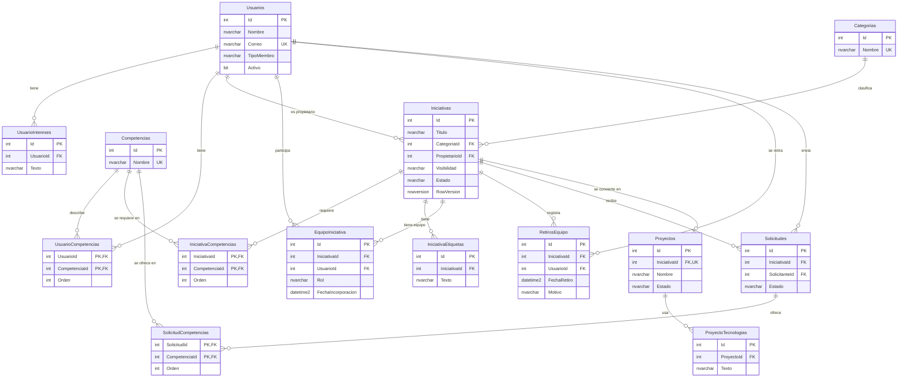

# Modelo de datos del Innovation Hub en SQL Server

Este documento pasa el modelo de MongoDB del Avance 2 a tablas de SQL Server. Es solo diseño, no se programa ni se ejecuta nada. En la entrega final estas tablas se convierten en código con Entity Framework Core. El modelo de MongoDB del Avance 2 se puede consultar en el historial de git, en la etiqueta `entrega-2`, y el contrato del API está en [api-contract.md](api-contract.md).

Decisiones generales:

- Las tablas principales e hijas tienen un `Id INT IDENTITY`; las tablas de unión sin identidad usan las claves compuestas indicadas en su descripción. En el JSON los identificadores siguen saliendo como texto, porque el contrato dice que son opacos.
- Las competencias y las categorías ya no usan el nombre como identificador. Tienen Id propio y el nombre queda UNIQUE.
- Todo arreglo del Avance 2 pasa a una tabla hija o a una tabla intermedia. Las listas de valores permitidos pasan a restricciones CHECK.
- Las reglas que dependen de contar filas de otra tabla (el cupo de un equipo, por ejemplo) las sigue validando el servidor dentro de una transacción.

## Diagrama



### Relaciones

- **usuario–competencia:** muchos a muchos. Un usuario tiene varias competencias y una competencia la tienen varios usuarios. Se resuelve con la tabla intermedia `UsuarioCompetencias` (UsuarioId, CompetenciaId), con llave primaria compuesta.
- **usuario–iniciativa:** hay dos relaciones. La de propietario es 1 a muchos: un usuario puede ser propietario de varias iniciativas y cada iniciativa tiene un solo propietario, así que se resuelve con la llave foránea `Iniciativas.PropietarioId → Usuarios`. La de participación en el equipo es muchos a muchos y además guarda datos propios (rol y fecha de incorporación), así que se resuelve con la tabla intermedia `EquipoIniciativa`, que tiene Id propio y un UNIQUE (IniciativaId, UsuarioId).
- **iniciativa–competencia:** muchos a muchos. Una iniciativa requiere varias competencias y una competencia se requiere en varias iniciativas. Se resuelve con la tabla intermedia `IniciativaCompetencias` (IniciativaId, CompetenciaId).
- **iniciativa–solicitud:** 1 a muchos. Una iniciativa recibe muchas solicitudes y cada solicitud es para una sola iniciativa. Se resuelve con la llave foránea `Solicitudes.IniciativaId → Iniciativas`. La solicitud también apunta a quien la envía con `Solicitudes.SolicitanteId → Usuarios` (otro 1 a muchos).
- **proyecto–usuario:** muchos a muchos. Un proyecto lo trabajan varias personas y una persona puede estar en varios proyectos. No lleva tabla propia porque en el Avance 2 el proyecto no copia a sus miembros: los integrantes son el equipo de su iniciativa. Se resuelve con la tabla intermedia que ya existe, `EquipoIniciativa`, pasando por `Proyectos.IniciativaId` (Proyectos → Iniciativas → EquipoIniciativa → Usuarios). Así el acceso nunca queda desactualizado.
- **proyecto–iniciativa:** uno a uno opcional desde la iniciativa (una iniciativa tiene cero o un proyecto; cada proyecto tiene exactamente una iniciativa). Se resuelve con la llave foránea `Proyectos.IniciativaId → Iniciativas` con restricción UNIQUE, porque una iniciativa se convierte como máximo en un proyecto.

### Del documento a la tabla

| Colección o arreglo del Avance 2 | Tipo en MongoDB | En qué quedó | Por qué |
| --- | --- | --- | --- |
| usuarios | colección | Usuarios | Es una entidad con vida propia. Se le quitan los arreglos para que cada columna guarde un solo valor. |
| usuarios.competencias | arreglo de referencias | UsuarioCompetencias | Es una relación muchos a muchos con el catálogo de competencias, por eso lleva tabla intermedia con llave compuesta. |
| usuarios.intereses | arreglo embebido de textos | UsuarioIntereses | Una columna no puede guardar una lista. Es 1 a muchos y los intereses solo existen dentro de su usuario, por eso se borran con él. |
| competencias | colección (catálogo) | Competencias | Sigue siendo un catálogo. Gana un Id numérico y el nombre queda UNIQUE (en MongoDB el _id era el nombre). |
| categorias | colección (catálogo) | Categorias | Igual que competencias: Id numérico y nombre UNIQUE. |
| iniciativas | colección | Iniciativas | Es la entidad central. Conserva sus datos propios y sus restricciones pasan a CHECK. |
| iniciativas.propietarioId | referencia | Iniciativas.PropietarioId (llave foránea → Usuarios) | Relación 1 a muchos. Una iniciativa tiene exactamente un propietario. |
| iniciativas.categoria | referencia | Iniciativas.CategoriaId (llave foránea → Categorias) | Relación 1 a muchos. Antes guardaba el nombre, ahora guarda el Id de la categoría. |
| iniciativas.competencias | arreglo de referencias | IniciativaCompetencias | Muchos a muchos con el catálogo de competencias, resuelto con tabla intermedia. |
| iniciativas.etiquetas | arreglo embebido de textos | IniciativaEtiquetas | Lista de textos que solo pertenecen a su iniciativa, así que pasa a una tabla hija 1 a muchos. |
| iniciativas.equipo | arreglo embebido de subdocumentos | EquipoIniciativa | Es la relación muchos a muchos entre usuarios e iniciativas y tiene datos propios (rol y fecha). Por eso es una entidad intermedia con Id propio. |
| iniciativas.retiros | arreglo embebido de subdocumentos | RetirosEquipo | Es el historial de quienes salieron. Va en su propia tabla para conservar la trazabilidad y para que impida borrar la iniciativa. |
| iniciativas.revision | campo numérico | Iniciativas.RowVersion | En MongoDB servía para forzar conflictos entre transacciones. En SQL Server se usa ROWVERSION, que EF Core aplica como control de concurrencia. |
| solicitudes | colección | Solicitudes | Crece sola y tiene su propio historial, filtros y paginación, así que sigue siendo una tabla aparte. |
| solicitudes.iniciativaId y solicitanteId | referencias | Solicitudes.IniciativaId y Solicitudes.SolicitanteId (llaves foráneas) | Relaciones 1 a muchos con Iniciativas y con Usuarios. |
| solicitudes.competencias | arreglo de textos que nombran competencias | SolicitudCompetencias | Muchos a muchos con Competencias. Lleva la columna Orden porque el contrato dice que la primera es la competencia principal. |
| proyectos | colección | Proyectos | Se mantiene como tabla propia, con vínculo permanente a la iniciativa original. |
| proyectos.iniciativaId | referencia única | Proyectos.IniciativaId (llave foránea UNIQUE → Iniciativas) | Una iniciativa genera como máximo un proyecto, y el UNIQUE lo garantiza en la base. |
| proyectos.tecnologias | arreglo embebido de textos | ProyectoTecnologias | Lista de textos que solo pertenecen al proyecto, tabla hija 1 a muchos. |
| sesiones | colección técnica (express-session) | No se migra | No es información del dominio, dura ocho horas y solo la usa el servidor Express. Al pasar al servidor final los usuarios vuelven a iniciar sesión. |
| _id (texto UUID) | identificador | Id INT IDENTITY | Cada fila recibe un número. Cómo se conservan las referencias se explica en el paso 4 del plan. |
| fechaCreacion y fechaModificacion | fechas de cada documento | FechaCreacion y FechaModificacion (DATETIME2) | Se conservan en UTC. Las fechas de calendario de proyectos pasan a DATE. |

## Tablas

Todas las fechas DATETIME2 están en UTC. Cuando una columna dice "Se impide", la llave foránea se crea sin borrado en cascada (NO ACTION en SQL Server, Restrict en EF Core) y la base rechaza el borrado. "Se borran también" significa ON DELETE CASCADE.

### Usuarios

Perfiles y cuentas. Reemplaza la colección usuarios (sin los arreglos).

| Columna | Tipo | ¿Obligatoria? | Llave | Regla |
| --- | --- | --- | --- | --- |
| Id | INT IDENTITY | Sí | Primaria |  |
| Nombre | NVARCHAR(100) | Sí |  |  |
| PrimerApellido | NVARCHAR(100) | Sí |  |  |
| SegundoApellido | NVARCHAR(100) | Sí |  | DEFAULT '' (vacío si no tiene) |
| Correo | NVARCHAR(254) | Sí |  | UNIQUE (no se repite, se guarda en minúsculas) |
| Hash | NVARCHAR(300) | Sí |  | Hash scrypt de la contraseña, nunca se devuelve en las respuestas |
| TipoMiembro | NVARCHAR(20) | Sí |  | CHECK: estudiante, docente o administrativo. DEFAULT 'estudiante' |
| Carrera | NVARCHAR(150) | Sí |  |  |
| Descripcion | NVARCHAR(1000) | Sí |  | DEFAULT '' |
| Disponible | BIT | Sí |  | DEFAULT 1 |
| Portafolio | NVARCHAR(300) | Sí |  | DEFAULT '' (vacío o una URL HTTPS) |
| Activo | BIT | Sí |  | DEFAULT 1. Las cuentas se desactivan, no se borran |
| AceptaTerminos | BIT | Sí |  | CHECK = 1 (sin aceptar términos no se crea la cuenta) |
| FechaCreacion | DATETIME2 | Sí |  | DEFAULT SYSUTCDATETIME() (fecha UTC de creación) |
| FechaModificacion | DATETIME2 | Sí |  | DEFAULT SYSUTCDATETIME(). Se actualiza en cada cambio |

Restricciones e índices de la tabla:

- Índice IX_Usuarios_Activo_Disponible_Nombre sobre (Activo, Disponible, Nombre) para el listado de colaboradores.

### Competencias

Catálogo de competencias. En MongoDB el _id era el nombre, ahora tiene Id propio y el nombre queda único.

| Columna | Tipo | ¿Obligatoria? | Llave | Regla |
| --- | --- | --- | --- | --- |
| Id | INT IDENTITY | Sí | Primaria |  |
| Nombre | NVARCHAR(100) | Sí |  | UNIQUE (el nombre sigue siendo el vocabulario controlado) |
| Categoria | NVARCHAR(100) | No |  |  |
| FechaCreacion | DATETIME2 | Sí | | Se copia del documento en UTC |
| FechaModificacion | DATETIME2 | Sí | | Se copia del documento en UTC |

### Categorias

Catálogo de categorías de iniciativa. Igual que Competencias, con Id propio y nombre único.

| Columna | Tipo | ¿Obligatoria? | Llave | Regla |
| --- | --- | --- | --- | --- |
| Id | INT IDENTITY | Sí | Primaria |  |
| Nombre | NVARCHAR(100) | Sí |  | UNIQUE |
| Categoria | NVARCHAR(100) | No |  | Campo opcional del esquema de catálogo compartido; se conserva si existe |
| FechaCreacion | DATETIME2 | Sí | | Se copia del documento en UTC |
| FechaModificacion | DATETIME2 | Sí | | Se copia del documento en UTC |

### UsuarioIntereses

Reemplaza el arreglo embebido intereses de usuarios.

| Columna | Tipo | ¿Obligatoria? | Llave | Regla |
| --- | --- | --- | --- | --- |
| Id | INT IDENTITY | Sí | Primaria |  |
| UsuarioId | INT | Sí | Foránea → Usuarios | Al borrar el usuario se borran también sus intereses (CASCADE) |
| Texto | NVARCHAR(100) | Sí |  | No se repite para el mismo usuario |

Restricciones e índices de la tabla:

- UNIQUE (UsuarioId, Texto) para que el arreglo siga sin duplicados.

### UsuarioCompetencias

Tabla intermedia usuario-competencia (muchos a muchos). Reemplaza el arreglo de referencias competencias de usuarios.

| Columna | Tipo | ¿Obligatoria? | Llave | Regla |
| --- | --- | --- | --- | --- |
| UsuarioId | INT | Sí | Primaria y foránea → Usuarios | Al borrar el usuario se borran también sus filas (CASCADE) |
| CompetenciaId | INT | Sí | Primaria y foránea → Competencias | Se impide borrar una competencia que algún usuario tiene |
| Orden | INT | Sí | | CHECK >= 1; UNIQUE (UsuarioId, Orden); conserva la posición en el arreglo |

Restricciones e índices de la tabla:

- La llave primaria compuesta evita que un usuario tenga la misma competencia dos veces.

### Iniciativas

Ideas, necesidades y retos. Reemplaza la colección iniciativas sin sus arreglos.

| Columna | Tipo | ¿Obligatoria? | Llave | Regla |
| --- | --- | --- | --- | --- |
| Id | INT IDENTITY | Sí | Primaria |  |
| Titulo | NVARCHAR(80) | Sí |  | Entre 5 y 80 caracteres (lo valida el servidor) |
| Tipo | NVARCHAR(10) | Sí |  | CHECK: Idea, Necesidad o Reto |
| Resumen | NVARCHAR(200) | Sí |  |  |
| Descripcion | NVARCHAR(1000) | Sí |  | Solo se muestra con acceso completo |
| Problema | NVARCHAR(500) | Sí |  | Solo se muestra con acceso completo |
| Beneficiarios | NVARCHAR(150) | Sí |  |  |
| CategoriaId | INT | Sí | Foránea → Categorias | Se impide borrar una categoría que tenga iniciativas |
| ParticipantesEstimados | INT | Sí |  | CHECK entre 1 y 50 (incluye al propietario) |
| Visibilidad | NVARCHAR(15) | Sí |  | CHECK: publica, institucional, restringida o privada |
| Estado | NVARCHAR(30) | Sí |  | CHECK: Borrador, Publicada, En formación de equipo, Convertida o Archivada. DEFAULT 'Publicada' |
| PropietarioId | INT | Sí | Foránea → Usuarios | Se impide borrar un usuario con iniciativas (se desactiva, no se borra) |
| RowVersion | ROWVERSION | Sí |  | Control de concurrencia. Reemplaza el campo revision de MongoDB |
| FechaCreacion | DATETIME2 | Sí |  | DEFAULT SYSUTCDATETIME() (fecha UTC de creación) |
| FechaModificacion | DATETIME2 | Sí |  | DEFAULT SYSUTCDATETIME(). Se actualiza en cada cambio |

Restricciones e índices de la tabla:

- Índice IX_Iniciativas_Visibilidad_Estado_Id sobre (Visibilidad, Estado, Id) para el catálogo según acceso.
- Índice sobre PropietarioId (lo crea EF Core para la llave foránea).

### IniciativaCompetencias

Tabla intermedia iniciativa-competencia (muchos a muchos). Reemplaza el arreglo competencias de iniciativas.

| Columna | Tipo | ¿Obligatoria? | Llave | Regla |
| --- | --- | --- | --- | --- |
| IniciativaId | INT | Sí | Primaria y foránea → Iniciativas | Al borrar la iniciativa se borran también sus filas (CASCADE) |
| CompetenciaId | INT | Sí | Primaria y foránea → Competencias | Se impide borrar una competencia que alguna iniciativa requiere |
| Orden | INT | Sí | | CHECK >= 1; UNIQUE (IniciativaId, Orden); conserva la posición en el arreglo |

Restricciones e índices de la tabla:

- Llave primaria compuesta: una iniciativa no repite competencia.

### IniciativaEtiquetas

Reemplaza el arreglo embebido etiquetas de iniciativas.

| Columna | Tipo | ¿Obligatoria? | Llave | Regla |
| --- | --- | --- | --- | --- |
| Id | INT IDENTITY | Sí | Primaria |  |
| IniciativaId | INT | Sí | Foránea → Iniciativas | Al borrar la iniciativa se borran también sus etiquetas (CASCADE) |
| Texto | NVARCHAR(20) | Sí |  | No se repite dentro de la misma iniciativa |

Restricciones e índices de la tabla:

- UNIQUE (IniciativaId, Texto).

### EquipoIniciativa

Tabla intermedia usuario-iniciativa con datos propios (rol y fecha). Reemplaza el arreglo embebido equipo de iniciativas.

| Columna | Tipo | ¿Obligatoria? | Llave | Regla |
| --- | --- | --- | --- | --- |
| Id | INT IDENTITY | Sí | Primaria | Identificador elegido para esta fila. Los datos propios requieren entidad intermedia en EF Core, pero también podría utilizar una PK compuesta |
| IniciativaId | INT | Sí | Foránea → Iniciativas | Al borrar la iniciativa se borra también su equipo (CASCADE). Así se puede eliminar una iniciativa que solo tiene al propietario |
| UsuarioId | INT | Sí | Foránea → Usuarios | Se impide borrar un usuario que está en un equipo |
| Rol | NVARCHAR(100) | Sí |  |  |
| FechaIncorporacion | DATETIME2 | Sí |  | DEFAULT SYSUTCDATETIME() |

Restricciones e índices de la tabla:

- UNIQUE (IniciativaId, UsuarioId): una persona no está dos veces en el mismo equipo.
- El cupo (integrantes menores o iguales a ParticipantesEstimados) y que el propietario entre al equipo lo valida el servidor dentro de una transacción, porque un CHECK no puede contar filas de otra tabla.

### RetirosEquipo

Historial de retiros. Reemplaza el arreglo embebido retiros de iniciativas.

| Columna | Tipo | ¿Obligatoria? | Llave | Regla |
| --- | --- | --- | --- | --- |
| Id | INT IDENTITY | Sí | Primaria |  |
| IniciativaId | INT | Sí | Foránea → Iniciativas | Se impide borrar la iniciativa si tiene retiros (el historial obliga a archivarla) |
| UsuarioId | INT | Sí | Foránea → Usuarios | Se impide borrar el usuario que se retiró |
| FechaRetiro | DATETIME2 | Sí |  | DEFAULT SYSUTCDATETIME() |
| Motivo | NVARCHAR(500) | Sí |  | DEFAULT '' |

### Solicitudes

Solicitudes de participación. Reemplaza la colección solicitudes sin su arreglo.

| Columna | Tipo | ¿Obligatoria? | Llave | Regla |
| --- | --- | --- | --- | --- |
| Id | INT IDENTITY | Sí | Primaria |  |
| IniciativaId | INT | Sí | Foránea → Iniciativas | Se impide borrar la iniciativa si tiene solicitudes de cualquier estado |
| SolicitanteId | INT | Sí | Foránea → Usuarios | Se impide borrar al solicitante |
| Mensaje | NVARCHAR(2000) | Sí |  |  |
| Disponibilidad | NVARCHAR(300) | Sí |  |  |
| RolSolicitado | NVARCHAR(100) | Sí |  | DEFAULT 'Colaborador' |
| Estado | NVARCHAR(10) | Sí |  | CHECK: pendiente, aceptada, rechazada o cancelada. DEFAULT 'pendiente' |
| FechaDecision | DATETIME2 | No |  | Queda vacía mientras la solicitud está pendiente |
| Respuesta | NVARCHAR(2000) | Sí |  | DEFAULT '' |
| FechaCreacion | DATETIME2 | Sí |  | DEFAULT SYSUTCDATETIME() (fecha UTC de creación) |
| FechaModificacion | DATETIME2 | Sí |  | DEFAULT SYSUTCDATETIME(). Se actualiza en cada cambio |

Restricciones e índices de la tabla:

- Índice único filtrado UX_Solicitudes_Pendiente sobre (IniciativaId, SolicitanteId) WHERE Estado = 'pendiente': solo puede haber una solicitud pendiente por persona e iniciativa, pero sí varias terminadas como historial.
- Índices IX_Solicitudes_Solicitante_Fecha (SolicitanteId, FechaCreacion DESC) e IX_Solicitudes_Iniciativa_Estado (IniciativaId, Estado, FechaCreacion DESC) para las listas.

### Proyectos

Proyectos creados al convertir una iniciativa. Reemplaza la colección proyectos sin su arreglo.

| Columna | Tipo | ¿Obligatoria? | Llave | Regla |
| --- | --- | --- | --- | --- |
| Id | INT IDENTITY | Sí | Primaria |  |
| IniciativaId | INT | Sí | Foránea → Iniciativas | UNIQUE (una iniciativa genera un solo proyecto). Se impide borrar una iniciativa que ya tiene proyecto |
| Nombre | NVARCHAR(150) | Sí |  |  |
| Descripcion | NVARCHAR(4000) | Sí |  |  |
| Objetivo | NVARCHAR(2000) | Sí |  |  |
| FechaInicio | DATE | Sí |  | Fecha de calendario |
| Estado | NVARCHAR(15) | Sí |  | CHECK: planificado, en_progreso, pausado, finalizado o archivado. DEFAULT 'planificado' |
| Repositorio | NVARCHAR(300) | No |  | Vacío o URL de GitHub con la forma https://github.com/owner/repo |
| FechaFinEstimada | DATE | No |  | CHECK: vacía o mayor o igual que FechaInicio |
| FechaCreacion | DATETIME2 | Sí |  | DEFAULT SYSUTCDATETIME() (fecha UTC de creación) |
| FechaModificacion | DATETIME2 | Sí |  | DEFAULT SYSUTCDATETIME(). Se actualiza en cada cambio |

### SolicitudCompetencias

Competencias que ofrece quien solicita (muchos a muchos). Reemplaza el arreglo competencias de solicitudes.

| Columna | Tipo | ¿Obligatoria? | Llave | Regla |
| --- | --- | --- | --- | --- |
| SolicitudId | INT | Sí | Primaria y foránea → Solicitudes | Al borrar la solicitud se borran también sus filas (CASCADE) |
| CompetenciaId | INT | Sí | Primaria y foránea → Competencias | Se impide borrar una competencia ofrecida en una solicitud |
| Orden | INT | Sí |  | CHECK mayor o igual que 1. El 1 es la competencia principal que ofrece (así lo pide el contrato) |

Restricciones e índices de la tabla:

- UNIQUE (SolicitudId, Orden): no hay dos competencias con el mismo orden en una solicitud.

### ProyectoTecnologias

Reemplaza el arreglo embebido tecnologias de proyectos.

| Columna | Tipo | ¿Obligatoria? | Llave | Regla |
| --- | --- | --- | --- | --- |
| Id | INT IDENTITY | Sí | Primaria |  |
| ProyectoId | INT | Sí | Foránea → Proyectos | Al borrar el proyecto se borran también sus tecnologías (CASCADE) |
| Texto | NVARCHAR(100) | Sí |  | No se repite dentro del mismo proyecto |

Restricciones e índices de la tabla:

- UNIQUE (ProyectoId, Texto).

## Plan de migración

Son seis pasos y hay que hacerlos en orden.

### Paso 1. Inventario

Estas son las colecciones del Avance 2 con sus campos. Un arreglo embebido es una lista que vive dentro del documento y una referencia es un campo que guarda el identificador de un documento de otra colección. Los campos salen de `servidor/src/datos/modelos.js`.

| Colección | Campos | Arreglos embebidos | Referencias a otra colección |
| --- | --- | --- | --- |
| usuarios | _id, nombre, primerApellido, segundoApellido, correo, hash, tipoMiembro, carrera, descripcion, disponible, competencias, intereses, portafolio, activo, aceptaTerminos, fechaCreacion, fechaModificacion | intereses (textos) | competencias[] → competencias |
| competencias | _id (igual al nombre), nombre, categoria, fechaCreacion, fechaModificacion | ninguno | ninguna |
| categorias | _id (igual al nombre), nombre, categoria (opcional), fechaCreacion, fechaModificacion | ninguno | ninguna |
| iniciativas | _id, titulo, tipo, resumen, descripcion, problema, beneficiarios, categoria, competencias, etiquetas, participantesEstimados, visibilidad, estado, propietarioId, equipo, retiros, revision, fechaCreacion, fechaModificacion | etiquetas (textos), equipo (usuarioId, rol, fechaIncorporacion), retiros (usuarioId, fechaRetiro, motivo) | categoria → categorias, competencias[] → competencias, propietarioId → usuarios, equipo[].usuarioId → usuarios, retiros[].usuarioId → usuarios |
| solicitudes | _id, iniciativaId, solicitanteId, mensaje, competencias, disponibilidad, rolSolicitado, estado, fechaDecision, respuesta, fechaCreacion, fechaModificacion | competencias (textos con el nombre de una competencia) | iniciativaId → iniciativas, solicitanteId → usuarios, competencias[] (por nombre) → competencias |
| proyectos | _id, iniciativaId, nombre, descripcion, objetivo, fechaInicio, estado, repositorio, tecnologias, fechaFinEstimada, fechaCreacion, fechaModificacion | tecnologias (textos) | iniciativaId → iniciativas |
| sesiones | _id (identificador de sesión), session (JSON serializado), expires (fecha de expiración) | ninguno | session.usuarioId → usuarios (referencia lógica dentro de la sesión; la cookie, no el _id de MongoDB, se firma) |

### Paso 2. Correspondencia

Es la tabla «Del documento a la tabla» de la sección Diagrama. En resumen, cada colección pasa a su tabla, cada arreglo pasa a la tabla hija o intermedia que lo reemplaza y cada referencia pasa a una llave foránea.

### Paso 3. Orden de creación de las tablas

Primero se crean las que no apuntan a ninguna otra y después las que dependen de ellas, porque no se puede crear una llave foránea hacia una tabla que todavía no existe.

```
1. Usuarios, Competencias, Categorias                                                                     (no dependen de nadie)
2. UsuarioIntereses, UsuarioCompetencias, Iniciativas                                                     (apuntan a Usuarios, Competencias y Categorias)
3. IniciativaCompetencias, IniciativaEtiquetas, EquipoIniciativa, RetirosEquipo, Solicitudes, Proyectos   (apuntan a Iniciativas, Usuarios y Competencias)
4. SolicitudCompetencias, ProyectoTecnologias                                                             (apuntan a Solicitudes, Proyectos y Competencias)
```

Para borrar todo se usa el orden contrario, del 4 al 1.

### Paso 4. Identificadores

En el Avance 2 el `_id` de usuarios, iniciativas, solicitudes y proyectos es un texto UUID que genera el servidor (`randomUUID`), y el de competencias y categorías es el propio nombre. En SQL Server cada fila recibe un Id numérico, así que hay que conservar las referencias con una tabla de equivalencias `_id` → Id.

```sql
CREATE TABLE MigracionEquivalencias (
    Coleccion NVARCHAR(30)  NOT NULL,
    IdMongo   NVARCHAR(100) NOT NULL,
    IdSql     INT           NOT NULL,
    CONSTRAINT PK_MigracionEquivalencias PRIMARY KEY (Coleccion, IdMongo),
    CONSTRAINT UQ_MigracionEquivalencias_Destino UNIQUE (Coleccion, IdSql)
);
```

Los pasos son estos:

1. Se crea `MigracionEquivalencias` antes de empezar.
2. Un script de migración recorre las colecciones en el orden del paso 3. Por cada documento hace el INSERT sin dar el Id (lo genera IDENTITY), recupera el Id nuevo con `OUTPUT INSERTED.Id` y guarda la pareja en la tabla de equivalencias.
3. Cuando un documento tiene una referencia (`propietarioId`, `categoria`, `usuarioId` del equipo, `iniciativaId` de una solicitud), el script busca el `_id` viejo en la tabla de equivalencias y escribe el Id nuevo en la llave foránea. Como las tablas se llenan en el orden del paso 3, el Id del padre ya existe cuando se necesita.
4. Los arreglos de nombres de competencias (en usuarios, iniciativas y solicitudes) se convierten buscando cada nombre en la equivalencia de `competencias`. En los arreglos con orden, como el de solicitudes, el orden del arreglo se guarda en la columna `Orden`.
5. Se conserva la equivalencia en un archivo de auditoría protegido después de validar la migración. Durante la carga se impone además UNIQUE (Coleccion, IdSql), se rechazan referencias sin correspondencia y nunca se omiten silenciosamente. La tabla es temporal de migración, no una entidad del dominio del diagrama.

Ejemplo de cómo se ven algunas equivalencias:

| Colección | _id en MongoDB | Id en SQL Server |
| --- | --- | --- |
| usuarios | 3c706588-c38e-541e-ae19-9d64a3765524 | 1 |
| usuarios | 596d7bfe-c507-53e9-9114-edefecaa4f28 | 2 |
| usuarios | df484a92-5a49-54fb-8611-1bebb8af1793 | 3 |
| usuarios | 0ca43b4b-32bd-567e-a2a5-8a1da9b62c1e | 4 |
| iniciativas | 6de553d8-c543-5eb0-972f-7c50aab710b4 | 1 |
| iniciativas | 2a3e214f-a141-5cb5-817e-93cafe39afb0 | 2 |
| iniciativas | 5b3e5b5c-c995-5027-b137-64d1334c712a | 3 |
| iniciativas | 9d25a0af-bc60-5e55-a3f1-ee733638be4d | 4 |
| competencias | React | 2 |
| competencias | Node.js | 3 |
| categorias | Educación | 2 |

Los UUID de la tabla son de ejemplo. Un INSERT que usa la equivalencia:

```sql
-- Ejemplo: pasar un miembro del arreglo iniciativas.equipo a la tabla EquipoIniciativa.
-- Los cuatro parámetros salen del documento de MongoDB y los Id nuevos salen de la tabla de equivalencias.
INSERT INTO EquipoIniciativa (IniciativaId, UsuarioId, Rol, FechaIncorporacion)
SELECT ei.IdSql, eu.IdSql, @Rol, @FechaIncorporacion
FROM MigracionEquivalencias AS ei
JOIN MigracionEquivalencias AS eu
  ON eu.Coleccion = 'usuarios' AND eu.IdMongo = @UsuarioIdMongo
WHERE ei.Coleccion = 'iniciativas' AND ei.IdMongo = @IniciativaIdMongo;
```

El formato sigue siendo texto opaco. Cambian los valores de todos los identificadores y, por tanto, las direcciones antiguas o favoritos que contengan UUID necesitan traducción con la equivalencia o una nueva consulta al catálogo. El cliente no debe convertirlos a número ni depender de la forma UUID.

### Paso 5. Carga de datos

Los datos se escriben en el mismo orden del paso 3. Los valores `(vacío)` son texto vacío, `NULL` es vacío de verdad. En Usuarios el hash se abrevia, en la migración real se copia completo y sin cambios.

#### 1. Usuarios

| Id | Nombre | PrimerApellido | SegundoApellido | Correo | Hash | TipoMiembro | Carrera | Disponible | Activo | AceptaTerminos | FechaCreacion |
| --- | --- | --- | --- | --- | --- | --- | --- | --- | --- | --- | --- |
| 1 | Ana | Rojas | Mora | ana.rojas@example.test | scrypt:a1… | estudiante | Ingeniería de Software | 1 | 1 | 1 | 2026-09-20 14:00:00 |
| 2 | Luis | Vargas | Solano | luis.vargas@example.test | scrypt:b2… | estudiante | Ingeniería de Software | 1 | 1 | 1 | 2026-09-21 15:30:00 |
| 3 | Marta | Chaves | Quesada | marta.chaves@example.test | scrypt:c3… | docente | Ingeniería de Software | 1 | 1 | 1 | 2026-09-22 16:00:00 |
| 4 | Diego | Mora | (vacío) | diego.mora@example.test | scrypt:d4… | estudiante | Diseño Gráfico | 1 | 1 | 1 | 2026-09-23 17:15:00 |

Descripcion y Portafolio quedan con su DEFAULT vacío y FechaModificacion es igual a FechaCreacion. Los hashes abreviados son una representación documental; no son credenciales utilizables. En una migración real se conserva cada hash completo y se comprueba la compatibilidad del verificador scrypt antes del cambio de servidor.

#### 2. Competencias

| Id | Nombre | Categoria |
| --- | --- | --- |
| 1 | JavaScript | Colaboración |
| 2 | React | Colaboración |
| 3 | Node.js | Colaboración |
| 4 | Bases de datos | Colaboración |
| 5 | Diseño de interfaces | Colaboración |
| 6 | Gestión de proyectos | Colaboración |

#### 3. Categorias

| Id | Nombre |
| --- | --- |
| 1 | Tecnología |
| 2 | Educación |
| 3 | Sostenibilidad |
| 4 | Salud y bienestar |

Para Competencias y Categorias, FechaCreacion y FechaModificacion de estos datos de prueba son `2026-09-20 12:00:00` UTC; Categoria de Categorias es NULL. En una migración real se copian las fechas y los valores opcionales originales.

#### 4. UsuarioIntereses

| Id | UsuarioId | Texto |
| --- | --- | --- |
| 1 | 1 | Aplicaciones web |
| 2 | 1 | Educación |
| 3 | 2 | Servicios en la nube |
| 4 | 3 | Sostenibilidad |
| 5 | 4 | Salud digital |

#### 5. UsuarioCompetencias

| UsuarioId | CompetenciaId  Orden |
| --- | --- | --- |
| 1 | 1  1 |
| 1 | 2  2 |
| 2 | 3  1 |
| 2 | 4  2 |
| 3 | 4  1 |
| 3 | 6  2 |
| 4 | 2  1 |
| 4 | 5  2 |

#### 6. Iniciativas

La tabla se muestra en dos partes por el ancho. Las dos comparten el Id. FechaModificacion se muestra en la primera parte.

| Id | Titulo | Tipo | CategoriaId | ParticipantesEstimados | Visibilidad | Estado | PropietarioId | FechaCreacion | FechaModificacion |
| --- | --- | --- | --- | --- | --- | --- | --- | --- | --- |
| 1 | Banco de tutorías entre pares | Idea | 2 | 4 | publica | En formación de equipo | 1 | 2026-10-01 15:00:00 | 2026-10-12 16:20:00 |
| 2 | Monitoreo del consumo eléctrico en laboratorios | Reto | 3 | 3 | institucional | Convertida | 3 | 2026-10-03 13:00:00 | 2026-10-20 18:00:00 |
| 3 | App de hábitos saludables | Necesidad | 4 | 4 | restringida | Publicada | 4 | 2026-10-08 14:45:00 | 2026-10-08 14:45:00 |
| 4 | Club de lectura técnica | Idea | 2 | 6 | publica | Publicada | 2 | 2026-10-15 19:10:00 | 2026-10-15 19:10:00 |

| Id | Resumen | Descripcion | Problema | Beneficiarios |
| --- | --- | --- | --- | --- |
| 1 | Plataforma donde estudiantes avanzados ofrecen tutorías cortas a compañeros de cursos básicos. | Se plantea un banco de tutorías donde cada estudiante publica los temas que domina y otros solicitan sesiones. El equipo diseñará el catálogo de temas, el agendado y el registro de horas de colaboración. | Los estudiantes de primeros cuatrimestres no encuentran apoyo académico oportuno. | Estudiantes de primer ingreso |
| 2 | Medir y visualizar el consumo eléctrico de los laboratorios de cómputo para reducir gastos y desperdicio. | Instalar sensores de bajo costo y construir un tablero web que muestre el consumo por laboratorio y por hora, con alertas cuando haya equipos encendidos fuera de horario. | No existe información del consumo real de cada laboratorio. | Escuela de Software y administración del campus |
| 3 | Aplicación móvil para que estudiantes registren sueño, hidratación y actividad física durante el cuatrimestre. | La app permitirá registrar hábitos diarios, fijar metas semanales y ver el progreso en gráficos sencillos. Se busca una interfaz clara y motivadora para uso diario. | El estrés académico afecta los hábitos de salud de los estudiantes. | Estudiantes de todas las carreras |
| 4 | Espacio quincenal para leer y discutir artículos y libros sobre ingeniería de software. | Cada dos semanas el grupo elegirá una lectura, la discutirá en una sesión corta y publicará un resumen con aprendizajes y preguntas abiertas para la comunidad. | Hay pocos espacios para discutir lecturas técnicas fuera de clase. | Estudiantes y docentes de Software |

#### 7. IniciativaCompetencias

| IniciativaId | CompetenciaId  Orden |
| --- | --- | --- |
| 1 | 1  1 |
| 1 | 2  2 |
| 1 | 4  3 |
| 2 | 3  1 |
| 2 | 4  2 |
| 2 | 6  3 |
| 3 | 2  1 |
| 3 | 5  2 |
| 4 | 1  1 |
| 4 | 6  2 |

#### 8. IniciativaEtiquetas

| Id | IniciativaId | Texto |
| --- | --- | --- |
| 1 | 1 | tutorías |
| 2 | 1 | comunidad |
| 3 | 2 | energía |
| 4 | 2 | sensores |
| 5 | 2 | tablero |
| 6 | 3 | bienestar |
| 7 | 4 | lectura |
| 8 | 4 | comunidad |

#### 9. EquipoIniciativa

| Id | IniciativaId | UsuarioId | Rol | FechaIncorporacion |
| --- | --- | --- | --- | --- |
| 1 | 1 | 1 | Coordinación | 2026-10-01 15:00:00 |
| 2 | 1 | 2 | Desarrollo backend | 2026-10-05 14:30:00 |
| 3 | 1 | 3 | Asesoría | 2026-10-12 16:20:00 |
| 4 | 2 | 3 | Líder | 2026-10-03 13:00:00 |
| 5 | 2 | 2 | Desarrollo | 2026-10-10 15:00:00 |
| 6 | 3 | 4 | Líder | 2026-10-08 14:45:00 |
| 7 | 4 | 2 | Coordinación | 2026-10-15 19:10:00 |

#### 10. RetirosEquipo

| Id | IniciativaId | UsuarioId | FechaRetiro | Motivo |
| --- | --- | --- | --- | --- |
| 1 | 2 | 4 | 2026-10-18 12:00:00 | Cambio de horario |

#### 11. Solicitudes

| Id | IniciativaId | SolicitanteId | Mensaje | Disponibilidad | RolSolicitado | Estado | FechaDecision | Respuesta | FechaCreacion |
| --- | --- | --- | --- | --- | --- | --- | --- | --- | --- |
| 1 | 3 | 1 | Me gustaría aportar con el desarrollo de la interfaz de la app. | Martes y jueves por la tarde | Desarrollo frontend | pendiente | NULL | (vacío) | 2026-10-20 20:00:00 |
| 2 | 1 | 3 | Puedo asesorar el diseño del banco de tutorías y la gestión del proyecto. | Miércoles de 2:00 p. m. a 4:00 p. m. | Asesoría | aceptada | 2026-10-12 16:20:00 | Bienvenida al equipo. | 2026-10-11 18:00:00 |

FechaModificacion de Solicitudes es igual a FechaCreacion para la solicitud 1 y a FechaDecision para la solicitud 2.

#### 12. Proyectos

| Id | IniciativaId | Nombre | FechaInicio | Estado | Repositorio | FechaFinEstimada | FechaCreacion |
| --- | --- | --- | --- | --- | --- | --- | --- |
| 1 | 2 | Monitor de energía en laboratorios | 2026-10-20 | en_progreso | https://github.com/example-org/monitor-energia | 2026-12-15 | 2026-10-20 18:00:00 |

| Id | Descripcion | Objetivo |
| --- | --- | --- |
| 1 | Sistema web que registra y muestra el consumo eléctrico de los laboratorios de cómputo para detectar equipos encendidos fuera de horario. | Reducir el consumo eléctrico de los laboratorios con datos casi en tiempo real. |

FechaModificacion del proyecto 1 es `2026-10-20 18:00:00` UTC.

#### 13. SolicitudCompetencias

| SolicitudId | CompetenciaId | Orden |
| --- | --- | --- |
| 1 | 2 | 1 |
| 1 | 1 | 2 |
| 2 | 6 | 1 |

#### 14. ProyectoTecnologias

| Id | ProyectoId | Texto |
| --- | --- | --- |
| 1 | 1 | React |
| 2 | 1 | Node.js |
| 3 | 1 | SQL Server |

#### Cómo se leen estas relaciones

Competencias de cada usuario (UsuarioCompetencias):

- Ana: JavaScript, React
- Luis: Node.js, Bases de datos
- Marta: Bases de datos, Gestión de proyectos
- Diego: React, Diseño de interfaces

Competencias que requiere cada iniciativa (IniciativaCompetencias):

- Banco de tutorías entre pares: JavaScript, React, Bases de datos
- Monitoreo del consumo eléctrico en laboratorios: Node.js, Bases de datos, Gestión de proyectos
- App de hábitos saludables: React, Diseño de interfaces
- Club de lectura técnica: JavaScript, Gestión de proyectos

Quién está en cada equipo (EquipoIniciativa):

- Banco de tutorías entre pares: Ana (Coordinación), Luis (Desarrollo backend), Marta (Asesoría)
- Monitoreo del consumo eléctrico en laboratorios: Marta (Líder), Luis (Desarrollo)
- App de hábitos saludables: Diego (Líder)
- Club de lectura técnica: Luis (Coordinación)

Niveles de visibilidad: la iniciativa 1 y la 4 son públicas, la 2 es institucional y la 3 es restringida. La iniciativa 2 está Convertida y por eso tiene su proyecto, y Diego aparece en RetirosEquipo porque salió de ese equipo. Marta está en el equipo de la iniciativa 1 porque se aceptó su solicitud 2, y la solicitud 1 de Ana sigue pendiente.

### Paso 6. Verificación

Después de cargar los datos hay que comprobar que no se perdió nada ni quedó nada suelto. Se hace en cuatro revisiones.

**1. Contar filas y compararlas con los documentos.** Cada colección debe dar las mismas filas que documentos, y cada arreglo debe dar tantas filas como elementos sumados en todos los documentos.

| Tabla | Filas con los datos de prueba | Se compara con (MongoDB) |
| --- | --- | --- |
| Usuarios | 4 | db.usuarios.countDocuments() |
| Competencias | 6 | db.competencias.countDocuments() |
| Categorias | 4 | db.categorias.countDocuments() |
| UsuarioIntereses | 5 | suma de $size de usuarios.intereses |
| UsuarioCompetencias | 8 | suma de $size de usuarios.competencias |
| Iniciativas | 4 | db.iniciativas.countDocuments() |
| IniciativaCompetencias | 10 | suma de $size de iniciativas.competencias |
| IniciativaEtiquetas | 8 | suma de $size de iniciativas.etiquetas |
| EquipoIniciativa | 7 | suma de $size de iniciativas.equipo |
| RetirosEquipo | 1 | suma de $size de iniciativas.retiros |
| Solicitudes | 2 | db.solicitudes.countDocuments() |
| Proyectos | 1 | db.proyectos.countDocuments() |
| SolicitudCompetencias | 3 | suma de $size de solicitudes.competencias |
| ProyectoTecnologias | 3 | suma de $size de proyectos.tecnologias |

En SQL Server:

```sql
SELECT 'Usuarios' AS Tabla, COUNT(*) AS Filas FROM Usuarios
UNION ALL SELECT 'UsuarioIntereses', COUNT(*) FROM UsuarioIntereses
UNION ALL SELECT 'Competencias', COUNT(*) FROM Competencias
UNION ALL SELECT 'Categorias', COUNT(*) FROM Categorias
UNION ALL SELECT 'UsuarioCompetencias', COUNT(*) FROM UsuarioCompetencias
UNION ALL SELECT 'Iniciativas', COUNT(*) FROM Iniciativas
UNION ALL SELECT 'IniciativaCompetencias', COUNT(*) FROM IniciativaCompetencias
UNION ALL SELECT 'IniciativaEtiquetas', COUNT(*) FROM IniciativaEtiquetas
UNION ALL SELECT 'EquipoIniciativa', COUNT(*) FROM EquipoIniciativa
UNION ALL SELECT 'RetirosEquipo', COUNT(*) FROM RetirosEquipo
UNION ALL SELECT 'Solicitudes', COUNT(*) FROM Solicitudes
UNION ALL SELECT 'SolicitudCompetencias', COUNT(*) FROM SolicitudCompetencias
UNION ALL SELECT 'Proyectos', COUNT(*) FROM Proyectos
UNION ALL SELECT 'ProyectoTecnologias', COUNT(*) FROM ProyectoTecnologias;
```

En MongoDB:

```javascript
// En mongosh, sobre la base innovation_hub (la de MONGODB_URI)
db.usuarios.countDocuments()
db.usuarios.aggregate([{ $group: { _id: null, total: { $sum: { $size: '$intereses' } } } }])
db.usuarios.aggregate([{ $group: { _id: null, total: { $sum: { $size: '$competencias' } } } }])
// y así con los demás arreglos: etiquetas, competencias, equipo y retiros de iniciativas,
// competencias de solicitudes y tecnologias de proyectos
```

**2. Revisar que las llaves foráneas quedaron bien.** La instrucción `DBCC CHECKCONSTRAINTS WITH ALL_CONSTRAINTS` revisa todas las restricciones de la base y no debe devolver ninguna fila.

**3. Revisar las reglas del Avance 2 con consultas.** Las tres deben devolver 0 filas, también con los datos de prueba:

```sql
-- Todo propietario debe estar en el equipo de su iniciativa (invariante del Avance 2)
SELECT i.Id
FROM Iniciativas AS i
WHERE NOT EXISTS (SELECT 1 FROM EquipoIniciativa AS e
                  WHERE e.IniciativaId = i.Id AND e.UsuarioId = i.PropietarioId);

-- Todo proyecto debe venir de una iniciativa Convertida
SELECT p.Id
FROM Proyectos AS p
JOIN Iniciativas AS i ON i.Id = p.IniciativaId
WHERE i.Estado <> 'Convertida';

-- Ningún equipo puede superar los participantes estimados
SELECT i.Id
FROM Iniciativas AS i
WHERE (SELECT COUNT(*) FROM EquipoIniciativa AS e WHERE e.IniciativaId = i.Id) > i.ParticipantesEstimados;
```

**4. Comparar respuestas del API.** Con la tabla de equivalencias del paso 4 se toman tres iniciativas, se pide `GET /api/initiatives/{id}` al servidor Express con el `_id` viejo y al servidor .NET con el Id nuevo, y se comparan tras traducir TODOS los identificadores mediante la equivalencia: id, propietarioId, equipo[].usuarioId, iniciativaId y cualquier referencia anidada. El orden de arreglos y las fechas se normalizan únicamente conforme al contrato; los nombres de campo y los permisos deben coincidir. Si un conteo no cuadra, no se borra nada en MongoDB hasta encontrar la diferencia.

## Controles adicionales del traslado

Antes de cargar: exportar MongoDB, registrar los conteos, detener temporalmente escrituras y validar duplicados, tipos, largos de texto y referencias. La carga se prepara en una base nueva; si algo falla se revierte la transacción de ese lote y se corrige el registro, conservando el origen intacto. No truncar textos para hacerlos caber: informar los casos que superen los tamaños elegidos. Correo se normaliza en minúsculas; los UNIQUE usan una intercalación acordada para que mayúsculas y acentos no creen colisiones inesperadas.

Los timestamps de catálogos se conservan. RowVersion NO copia el número revision: SQL Server genera un token binario nuevo. El valor viejo queda en el respaldo de auditoría; la concurrencia se reinicia deliberadamente al cambiar de servidor. HasData es para las semillas del laboratorio, no para migrar arbitrariamente la base del proyecto.

Para conservar el orden de los arreglos de textos sin Id y de referencias (usuarios.competencias e iniciativas.competencias), se agrega **Orden INT NOT NULL CHECK (Orden >= 1)** a UsuarioCompetencias e IniciativaCompetencias, con **UNIQUE (UsuarioId, Orden)** y **UNIQUE (IniciativaId, Orden)** respectivamente. El diagrama anterior muestra las claves; Orden es un atributo ordinario, no una llave foránea. Los datos del paso 5 asignan Orden=1,2,... según el orden en que aparece cada pareja dentro de su usuario o iniciativa. En las tablas hijas con Id, se genera cada Id siguiendo el orden de los elementos del documento y se responde con ORDER BY Id. SolicitudCompetencias conserva el orden explícito documentado. Esta política permite reconstruir los arreglos sin suponer que una tabla tiene orden implícito.

Reglas que requieren transacción del servidor: propietario activo e incluido en su equipo; aceptación de una solicitud e ingreso al equipo en una sola unidad; prohibición de retirar al propietario; cupo máximo; conversión única con al menos otro miembro; exclusividad del propietario para modificar; archivo de iniciativas con historia o con más de un integrante. Un CHECK de una fila no garantiza estas condiciones entre tablas. La aplicación serializa las modificaciones de la iniciativa (bloqueo de fila o aislamiento equivalente) y reintenta o informa los conflictos de RowVersion.

La eliminación física de una iniciativa con solo su propietario puede eliminar ese miembro automático en cascada. Si hay otro miembro debe archivarse aunque no haya solicitudes: una FK con CASCADE por sí sola no aplica esa regla. No hay dos caminos de CASCADE desde Usuarios hacia EquipoIniciativa porque su FK a Usuarios usa NO ACTION.

La verificación compara también conjuntos de referencias (no solo cantidades), campos escalares, suma de longitudes de cada arreglo, orden y ausencia de huérfanos. Tras comparar las dos rutas como visitante y como usuarios con distintos permisos, realizar una copia de seguridad de SQL Server y habilitar el nuevo servidor. Si falla la validación, se mantiene el servicio anterior y se restaura la copia nueva; no mezclar escrituras entre ambas bases durante la transición.
